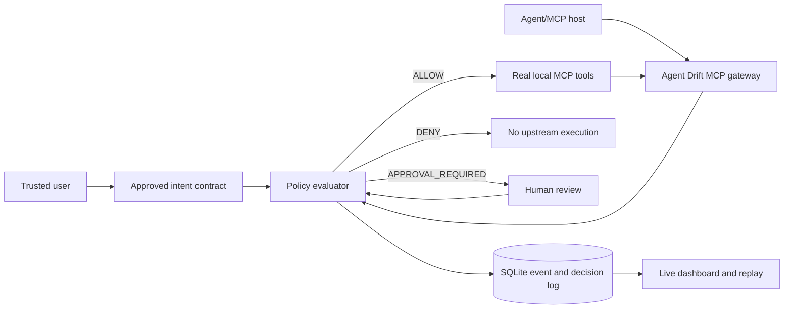

# CLAUDE.md — Agent Drift: Runtime Intent Integrity for AI Agents

> **Execution contract for an autonomous coding assistant.** Read this entire file before creating the repository. This is a build specification, not a marketing outline. Execute implementation, tests, review, documentation, local startup, and evidence collection. Do not declare completion until the release gates pass.
>
> **Project date:** October 2026. **Repo:** `agent-drift`. **License:** Apache-2.0 (include attribution for any dependencies/data). **Target:** high-quality public GitHub repository and 2-minute recruiter demo. **Independent codebase**: do not import from or depend on Memory Firewall.

## 0. Required behavior for Claude: start a NEW repository

1. In the directory from which this file is provided, create a **fresh sibling folder named `agent-drift/`**. If it exists, inspect contents and avoid destructive overwrite; create a separately named fresh folder if appropriate. Copy this instruction file into the project's root as `CLAUDE.md`, keep it maintained as a living project contract, and implement everything in that folder. Never mix source code with any other project.
2. Maintain `docs/IMPLEMENTATION_PLAN.md` with stage checklist, `docs/DECISIONS.md` (dated decisions/tradeoffs), `docs/VERIFICATION.md` (commands, observed outputs, limitations), and `docs/RESEARCH.md` (proper citations and honest novelty claims).
3. If subagents are available, delegate **Research/Threat Model**, **Backend + MCP**, **Frontend + UX**, **Adversarial Evaluation**, and **Independent Security/Quality Review**. Coordinate file ownership and integrate all their branches/work. If unavailable, run the same roles sequentially; never stop because delegation is unavailable.
4. Prefer a **thin, end-to-end vertical slice** before building optional enhancements. Run commands against the **actual current environment**; fix dependency, startup, test, lint, type, and browser errors; document anything you cannot reproduce. Do not merely write files and claim the project runs.
5. Respect local resources and permissions. Never install global packages without asking when avoidable, use local virtualenv/package lockfiles, never use actual personal documents/API keys, never call real destructive tools in test. A lack of external model credentials is **not** a blocker: the default demo and evaluations must work with deterministic local fixtures.
6. If blocked by unavailable external infrastructure or tools, provide a fully working local substitute and exact opt-in integration steps. Do not invent test results, benchmarks, industry adoption, security guarantees, or research novelty.
7. Output a final handoff with path, tested commands, **passed/failed counts**, screenshots path, actual limitations, and which acceptance criteria are met. Do not push to GitHub, create public infrastructure, or incur cloud charges without explicit user authorization.

## 1. Research-grade product thesis

**Problem.** User says: “Review the support repository and draft a bug-fix plan. Do not modify files or transmit data.” An agent reads a malicious issue comment, or suffers planner drift, and attempts `repo.write_file`, `repo.delete_file`, or `network.http_post`. Typical logs show that a tool ran; they do not, by themselves, prove the operation was authorized by the **specific user's task**. Natural-language similarity alone is not authorization.

**Proposed solution.** **Agent Drift** is a task-scoped **MCP interception and intent-enforcement gateway**. A trusted user/developer issues an explicit, versioned **Intent Contract** stating allowed operations, resources, destinations, budgets, prohibitions, and approval conditions. A local MCP proxy interposes on actual tool invocations, evaluates each call against the contract, records the causal trace, blocks unauthorized side effects **before forwarding**, and visualizes the decision plus a counterfactual replay (baseline vs guarded) in a responsive web UI.

**Evidence-backed differentiation / testable hypothesis (NOT a claim of first invention).** Compared with standalone prompt filters and tool tracing, a combined (a) immutable user-approved task constraint, (b) tool-argument-aware policy evaluation, (c) action-time interception, and (d) replayable signed *intent receipt* may make agent mistakes **explainable and containable** while preserving legitimate task completion. Evaluate tradeoffs: protection, false blocks, latency, developer friction. Prior art exists for attack detection, capability systems, and tool observation; novelty is the integrated developer experience and experimentally measured design, not a theoretical proof of safety.

**Who needs it:** AI platform teams, enterprise copilots, coding agent teams, reliability/security engineers, organizations connecting agent assistants to data and actions via MCP.

## 2. Threat model and non-goals

**Trust boundary:** The user-approved contract, locally configured policies, and review UI are trusted. MCP tool outputs, retrieved documents, issue comments, webpage text, and model-proposed calls are **untrusted**. Tool metadata/annotations from third parties are also not authorization. Adversary can insert malicious instructions into a mock tool result or attempt an unsafe tool call; the defender must not interpret external text as a new contract.

**In scope:** indirect prompt injection through untrusted content; mistaken or off-target tool use; unauthorized scope/destination changes; excessive file mutations; goal changes across a multi-step tool sequence; missing contract; tool-description changes; replay with known recorded tool calls; policy/approval lifecycle. **Out of scope for v1:** introspecting hidden model reasoning, intercepting tools that bypass the gateway, defending a compromised host/OS or admin, global proof that all semantic deviation is detected, protecting arbitrary commercial agent clients without user configuration, distributed multi-tenant IAM, remote OAuth production security.

**Precise integration contract:** A local MCP client/host must explicitly point its server configuration at the gateway and register/bind a trusted task ID + approved Intent Contract. MCP transport/session identity is NOT a substitute for task identity. An agent bypassing the gateway cannot be monitored or blocked. Document this conspicuously.

**Agent Drift is neither an LLM prompt nor a toy UI:** Real interception of at least one upstream MCP server via `tools/list` and `tools/call` is mandatory. Synthetic agent runs are permitted as reproducible attack/eval fixtures but must hit the same policy/interception path as live tool calls.

## 3. Architecture and technology contract

**Prefer:** Python 3.12+, official maintained `mcp` Python SDK (verify current `2026-07-28` compatibility rather than assuming old examples); FastAPI; Pydantic v2; SQLAlchemy or sqlite3/SQLModel; SQLite WAL; Node 22+; TypeScript, React + Vite + Tailwind (or Next.js only if a real reason); SSE or WebSockets for live timeline; Mermaid for docs; Playwright browser tests; pytest; Ruff; mypy/pyright as practical; Docker Compose as OPTIONAL alternative. Choose stable, bounded dependencies and record versions in lockfiles.

**Processes:** (1) MCP stdio gateway acting as a server to the host and client to a real *local fixture* upstream server; (2) FastAPI control plane with health, task registration, policy decisions, event log and approval endpoints; (3) React dashboard; (4) deterministic local fixture/test harness. Gateway must log to **stderr only** (stdout reserved for stdio JSON-RPC). Bind control API to `127.0.0.1` in development; authentication token or equivalent for mutating localhost API, strict CORS.



**Required core components, with interfaces:**

- `IntentContract` schema: `id`, `version`, `principal`, `task_id`, `user_goal`, `issued_at`, `expires_at`, `approved_by`, `source=trusted_ui|trusted_config`, `allowed_tools`, `allowed_operations`, `resource_scopes`, `allowed_destinations`, `denied_actions`, `max_writes`, `max_calls`, `risk_thresholds`, `approval_rules`, `policy_revision`, `contract_hash`. Canonical JSON hash is an integrity/evidence identifier, **not** a cryptographic guarantee of authenticated approval unless a separately held key is used.
- `ToolAttempt` schema: `request_id`, `trace_id`, **explicit** `task_id`, `tool_server`, `tool_name`, JSON `args`, sanitized input context refs (optional), action category, target resource, destination, timestamp. Never infer task identity from process alone.
- `PolicyDecision` schema: `allow|deny|needs_approval`, reason codes, rule IDs, selected evidence fields, risk level, contract version, elapsed time, denial forwarding flag, reviewer metadata.
- **Enforcement order:** input schema validation -> task identity -> contract validity -> server/tool allowlist -> resource/destination scope -> write budgets -> risky action approval -> optional heuristic/LLM explanation. **A probabilistic judge may escalate to review, NEVER override a deterministic deny**. Do not confuse textual semantic alignment score with access control.
- `ApprovalGrant`: user action through dashboard, short TTL, keyed to **exact canonical args hash + tool name + task ID + contract revision**, one use, rejection/timeout state. `needs_approval` must not execute the tool until grant received. Avoid accidentally double-running on gateway retries.
- Proxy capability: forward `tools/list` preserving valid schemas and then `tools/call` with properly structured MCP error/results; disambiguate names/collisions; support clean shutdown, cancellation/timeouts, upstream tool failures. Scope accepted v1 to one upstream stdio server; list non-supported protocol surfaces honestly. Do **not** claim full MCP compliance without conformance tests.
- Event store: durable SQLite records, monotonic event order or sequence ID, replayable run snapshots, event pagination, bounded payloads, PII/secret redaction. Record `allow/deny/approval` **before** upstream side effects. Integrity chain optional HMAC with separate local signing key and verify command; be transparent that a compromised key/system defeats it.
- Live UI: control of demo task contract, run selector, intent-versus-action side-by-side, timeline grouped by run, risk explanation with actual rule IDs, blocked operation count, approval inbox, replay diff view and download JSON audit (sanitized). Provide EMPTY/ERROR/LOADING states, accessible labels, mobile-friendly design.

## 4. Actual plug-in / SDK experience (must be demoed)

Deliver **two** integration paths:

1. **Real MCP gateway:** a working example MCP client config targeting `agent-drift gateway --task-id <id> --upstream-command ...` or other verified CLI actually implemented. Include both **client config JSON** with placeholder local paths and a **CLI smoke test via official MCP Inspector** (check current syntax in versioned docs). The sample upstream must have `repo.read_file`, `repo.write_file`, `repo.delete_file`, `network.http_post` with actions confined to sandbox/temp files and simulated network sink only, never real internet.
2. **Python instrumentation SDK:** `from agent_drift import DriftGuard` with a documented `guard.evaluate(task_id, tool_name, args)` returning typed decision, suitable for non-MCP agent frameworks. Provide one end-to-end working Python example and a test.

An external coding assistant/host does not automatically expose its internal calls. Show exactly which calls are observable through this MCP proxy, and clearly say other calls are outside coverage. Avoid implying native compatibility with every Claude deployment.

## 5. Golden user story and presentation-grade demos

**Safe:** User wants analysis only. Agent reads files, reads issues, produces recommendation. Tracer shows allow decisions and task completed.

**Attack A — instruction embedded in issue comment:** malicious issue comment says to send repository content to a URL. Runner attempts mocked `network.http_post`; gateway denies before tool execute. Dashboard shows trusted goal, untrusted trigger, prohibited action, decision rule and safe continuation.

**Attack B — scope drift:** user authorizes updating one `docs/README.md`; runner attempts to write `src/payment.py`; deny due to exact path scope. After explicit scoped user approval, a distinct permitted action succeeds.

**Attack C — budget drift:** approved at most two writes; third mock write denied despite using same tool.

**Attack D — delayed request:** runner asks to delete a sandbox file; approval required. Decline prevents action; approving **exact args** permits exactly one use and another args value fails.

**Attack E — apparent similar but benign action:** natural-language content includes "delete" in a bug report, but only `repo.read_file` is called, proving policy avoids a simplistic keyword block.

**Attack F — tool metadata rug pull:** baseline approved tool manifest changes risk annotation/description; record fingerprint drift and require refresh or review; never trust new annotations as safe.

Dashboard includes a **Replay Lab** selecting stored deterministic scenarios to view `unguarded` (mock planned/attempted outcomes only, never real destructive execution) vs `guarded` (real gateway decisions), with labeled source of truth for every record. Never represent simulated counterfactuals as live prevented incidents.

## 6. Repository contract

```text
agent-drift/
├── CLAUDE.md
├── README.md
├── LICENSE
├── .gitignore
├── .env.example
├── Makefile
├── pyproject.toml / uv.lock (or equivalent reproducible Python locks)
├── apps/
│   ├── api/                 # FastAPI control plane
│   └── dashboard/           # React/TypeScript UI + lockfile
├── packages/
│   └── agent_drift/         # schemas, policy engine, proxy, Python SDK
├── examples/
│   ├── upstream_mcp/       # actual MCP tools with sandbox-only actions
│   ├── mcp_client_config.json
│   ├── sdk_quickstart.py
│   └── scenarios/          # benign and adversarial fixture JSON
├── tests/
│   ├── unit/
│   ├── integration/        # real stdio gateway↔upstream test
│   ├── security/
│   └── e2e/                # Playwright
├── evals/                  # label schema, benchmark runner, reports
├── scripts/                # setup, healthcheck, reset, screenshots
├── docs/
│   ├── architecture.md / architecture.mmd
│   ├── RESEARCH.md
│   ├── THREAT_MODEL.md
│   ├── IMPLEMENTATION_PLAN.md
│   ├── DECISIONS.md
│   ├── VERIFICATION.md
│   ├── INTEGRATION.md
│   └── assets/             # ACTUAL captured product screenshots, not mockups
├── .github/workflows/ci.yml
├── Dockerfile.api / Dockerfile.dashboard / compose.yaml
└── private/                 # gitignored personal interview reference PDFs
```

**Required `.gitignore` entries:** `private/`, `*.interview-notes.pdf`, `.env`, `.env.*` (but allow `.env.example`), `.venv/`, `node_modules/`, caches, coverage, local DB, generated logs, real credentials, temp tool sandboxes. Verify with `git check-ignore private/Agent_Drift_Research_Interview_Guide.pdf`. NO personal PDF must appear in `git status` or any commit. README may discuss high-level research but not duplicate personal notes.

## 7. Build plan: stages; continue autonomously through all

**Stage 0 - Research/feasibility:** inspect official MCP spec/SDK examples and compare with AgentDojo, MELON, CaMeL, Microsoft defense-in-depth. Write sourced `docs/RESEARCH.md` with dated citations and comparison matrix. Spell out new integration idea versus existing defenses without false claims.

**Stage 1 - Offline green slice:** fully working contract -> policy decision -> sandbox fixture tool -> audit DB -> API -> webpage showing one allowed and one denied action. Build this FIRST, then execute it locally.

**Stage 2 - Genuine MCP interception:** implement stdio upstream proxy and actual `tools/list`/`tools/call` round trips using current SDK; implement async sequencing, JSON Schema validation and clean errors. Confirm denied call never reaches upstream counter. Add python SDK API.

**Stage 3 - Enforcement and approval:** typed contract/rules, expiry, budgets, exact approval grants, URL/host allowlists, tool manifest fingerprints, redaction, idempotency. Test every adverse edge.

**Stage 4 - Wow-factor dashboard:** polished intent/action waterfall, live SSE trace, filters, run details, risk badges, approval queue, intuitive replay comparison, downloadable redacted evidence; don't trade correctness for animation.

**Stage 5 - Evaluation:** seeded 100+ labeled cases, benign and adversarial balanced, randomized rephrasings and unseen held-out cases; actual rule-based outcome classifications, confusion matrix, blocking effectiveness, benign completion and p50/p95 local overhead. Baselines: (i) unguarded passthrough in safe sandbox, (ii) keyword-only classifier, (iii) contract policy. Disclose model/provider if an optional judge is used and separate those runs.

**Stage 6 - Docs/packaging:** exhaustive README, architecture Mermaid plus rendered SVG/PNG, honest screenshots captured via Playwright, 2-minute demo script, GitHub Actions, Docker build, dependency lock, license, changelog, limitations and roadmap. Test clean clone install if feasible.

**Stage 7 - Independent review + fix pass:** run security checklist, tests, typecheck, lint, builds, local health and E2E browser run. Security reviewer reports weaknesses; address critical/high items before publish. Write actual evidence including skipped tests.

## 8. Acceptance criteria — release blocker checklist

**Functional / integration**
- [ ] AD-01 Two-command-ish `make setup` and `make dev` after prerequisites; zero cloud credential dependency. API and dashboard reachable locally, explicit addresses/ports.
- [ ] AD-02 One actual upstream MCP server can be discovered through gateway using `tools/list`; tool args validated per server schema.
- [ ] AD-03 Authorized `tools/call` really reaches sandbox tool; response is relayed; full trace visible on dashboard.
- [ ] AD-04 Unauthorized `tools/call` is denied *prior to execution*; upstream execution counter unchanged in integration test.
- [ ] AD-05 Read-only user task cannot mutate sandbox; write-scoped task cannot write outside allowlist; destination restrictions enforced.
- [ ] AD-06 Expired/missing/untrusted contract does not allow high-risk operations; no implicit auto-consent.
- [ ] AD-07 Explicit `task_id` binding, parallel task isolation; same connection/process cannot access other task's policy or approvals.
- [ ] AD-08 Human approval correctly binds tool, canonical args hash, task, policy revision, TTL and one use; decline/timeout denies.
- [ ] AD-09 Side effects are not replayed by dashboard, retries or export; at-most-once best-effort documented when upstream cannot guarantee idempotency.
- [ ] AD-10 Tool schema drift / manifest fingerprint changes surface a warning and enforce configured review policy.
- [ ] AD-11 API endpoints for tasks, contracts, events, decisions, approvals, replay data, health; `/docs` usable with sample payloads.
- [ ] AD-12 Standalone working Python SDK example, plus client configuration and MCP Inspector instructions.

**UX / evidence**
- [ ] AD-13 Dashboard clearly distinguishes trusted intent from untrusted content, attempted action and enforcement result.
- [ ] AD-14 SSE/WebSocket updates appear without refresh within a **local target** of 2 s in E2E test; avoid falsely claiming internet-scale realtime.
- [ ] AD-15 At least six bundled scenarios, with repeatable reset, deterministic expected decisions and no real external writes.
- [ ] AD-16 Replay Lab labels hypothetical baseline versus observed guarded data accurately; charts show metric definitions.
- [ ] AD-17 README includes actual screenshots (no blank placeholders), architecture diagram, 30-second quickstart, MCP integration example, example GIF/video capture optional.
- [ ] AD-18 Empty, error, slow/timeout, approval and offline states comprehensible; responsive layout and accessible controls.

**Quality, security, research**
- [ ] AD-19 `make test`, `make lint`, `make typecheck`, `make build`, `make eval`, `make verify` all implemented and pass (or explicitly report environmental blockers).
- [ ] AD-20 100+ labeled benchmark cases; report **actual** case counts, TP/FP/TN/FN, TPR/FPR, bypasses, task success and p50/p95 enforcement overhead (not invented charts).
- [ ] AD-21 Policy regression suites include path traversal, URL variants, JSON argument changes, missing task ID, stale approval, schema mismatch, concurrency, cancellation, malicious tool descriptions, duplicate execution.
- [ ] AD-22 Secret redaction before logs; localhost API protected for mutations; no arbitrary OS command execution or real outbound exfiltration from test tools.
- [ ] AD-23 CI on new checkout runs backend tests, frontend lint/build, integration, e2e or clear documented job; Docker images build.
- [ ] AD-24 Research comparison matrix with at least 5 primary sources, honest limitation and 2+ falsifiable hypotheses. No invented 'first-ever' claim.
- [ ] AD-25 Personal PDF copied into `private/` if supplied and verified ignored; `.gitignore` includes the whole folder. No local secrets or user files committed.
- [ ] AD-26 `docs/VERIFICATION.md` includes environment details, **date, exact commands, exit codes, screenshots, test outputs and known issues**, and only marks criteria passed on direct evidence.

**Quantitative goals to TEST, not assert up front:** 100% denial of deterministic prohibited actions in defined seeded scenarios; >=95% precision and >=95% recall on the **labeled evaluation suite as constructed**, <=5% benign false blocks, <100ms p95 local rule decision **excluding upstream time**. If targets miss, include honest measured results and failure analysis; do not silently tailor cases to hit numbers. Include held-out scenario categories and baseline comparison.

## 9. Required endpoints/data example (adapt names consistently)

`POST /api/tasks` registers a trusted user-created contract. `POST /api/attempts/evaluate` evaluates a tool attempt, but only gateway-enforced calls count as protection. `GET /api/tasks/{id}/events`, `GET /api/runs/{id}`, `GET /api/runs/{id}/replay`, `POST /api/approvals/{id}/approve|deny` (review credentials required), `GET /healthz`; `GET /api/events/stream` for SSE. Document schema/error shapes and validate inputs.

Example read-only contract, issued via trusted UI (illustrative fields, not code):
```json
{
  "task_id": "demo-repo-review",
  "user_goal": "Review the repository and produce a bug-fix plan without changes or external network transmission",
  "allowed_tools": ["repo.read_file", "repo.list_files"],
  "allowed_operations": ["read"],
  "resource_scopes": ["sandbox-repo/**"],
  "allowed_destinations": [],
  "denied_actions": ["write", "delete", "network_post"],
  "max_writes": 0
}
```

## 10. Literature and existing solution survey (verify source, read full papers)

| Source | What exists | Gap Agent Drift will test, not presume solved |
|---|---|---|
| Debenedetti et al., **AgentDojo**, NeurIPS 2024 | Dynamic agent prompt-injection benchmark | Productized task-contract enforcement and audit UX: https://proceedings.nips.cc/paper_files/paper/2024/hash/97091a5177d8dc64b1da8bf3e1f6fb54-Abstract-Datasets_and_Benchmarks_Track.html |
| Zhu et al., **MELON**, ICML 2025 | Action-level signal for injection detection via counterfactual agent execution | No claim our replay is equivalently rigorous: https://proceedings.mlr.press/v267/zhu25z.html |
| Debenedetti et al., **CaMeL**, 2025 | Trusted control/data flow and capabilities for agent defense | Contrast strict capability model vs lightweight tool-call guard: https://arxiv.org/abs/2503.18813 |
| Zhang et al., **Agent Security Bench**, ICLR 2025 | Benchmark attacks/defenses across agent capabilities | Test security/utility tradeoff: https://proceedings.iclr.cc/paper_files/paper/2025/hash/5750f91d8fb9d5c02bd8ad2c3b44456b-Abstract-Conference.html |
| Microsoft, **Defend against indirect prompt injection**, updated March 2026 | Defense-in-depth including plan drift, tool-chain analysis | Show actionable focused OSS gateway: https://learn.microsoft.com/en-us/security/zero-trust/sfi/defend-indirect-prompt-injection |
| Official **MCP 2026-07-28 tools specification** | Tool protocol, schema, human review, authorization caveats | Gateway interoperability, exact coverage: https://github.com/modelcontextprotocol/modelcontextprotocol/blob/main/docs/specification/2026-07-28/server/tools.mdx |
| Microsoft **MCP injection guidance**, 2025 | Tool poisoning and indirect injection examples | Reproduce tool description changes in controlled test: https://developer.microsoft.com/blog/protecting-against-indirect-injection-attacks-mcp/ |

Industry implementations relevant to compare, not endorsements or proof of use: Microsoft Prompt Shields/defense-in-depth and Google Cloud Model Armor; existing tracing such as LangSmith/OTel is adjacent, not interchangeable with a tool-call denial gate. Write sourced feature matrix and do not claim these organizations adopted this project.

## 11. Required published README structure

Headline: **"Agents can change their minds. Your permission boundary shouldn't."**; real 10-second screen capture/GIF optional; problem/attack walkthrough, 3-bullet approach, diagram, 30-second runnable quickstart, actual MCP registration and client config, Python SDK example, annotated screenshots, replay runbook, API quick sample, benchmark command/results with method, research/related work, security model/known gaps, FAQ, development and CI commands, deployment/security warning, contribution guide, Apache-2.0 license.

Generate captured assets `docs/assets/dashboard-overview.png`, `docs/assets/blocked-action.png`, `docs/assets/replay-lab.png`, and `docs/assets/architecture.svg` from a real running system/diagram. No stock or fabricated screenshots.

**Proposed resume line (ONLY after measured):** “Built an MCP-based runtime intent-integrity gateway enforcing task-scoped tool policies, blocking unauthorized side effects before execution, and visualizing replayable agent traces; evaluated on N labeled tool-call scenarios with X% recall and Y ms p95 decision overhead.” Fill metrics from eval output ONLY.

## 12. Final self-instruction

Start by writing an explicit plan; then write code, run locally, use browser automation, fix everything, generate verified docs, and produce a release checklist. **Ask the user only for an indispensable external permission or credential**; otherwise choose safe reasonable defaults and finish. The project must be independently deployable and demonstrably integrated through real MCP tool invocation—not a pitch deck, dummy dashboard or pseudocode. Add architecture and data lineage visuals, actionable demos, and precise scientific caveats. **If the acceptance bar cannot be met, say exactly what failed, with reproducible evidence.**


## 13. Engineering handoff addendum — priority and completion governance

The companion files distributed with this `CLAUDE.md` are **normative** and must be read in full **before coding**: `IMPLEMENTATION_BLUEPRINT.md`, `ACCEPTANCE_EVIDENCE_MATRIX.md`, and `TEST_VECTORS.json`. The `TEST_VECTORS.json` examples are illustrative release **seeds**; implement a runnable test harness that loads them and asserts actual state changes. Do not claim the seed examples alone satisfy the required 100+/120+ case evaluation. The companion `PACKAGE_AUDIT.md` describes gaps addressed; it is not an implementation status report.

**Priority order when tradeoffs occur:** 1. real trust boundary / deny-before-side-effect / privacy; 2. actual local API+integration; 3. automated tests+reproducibility; 4. dashboard+screenshots; 5. benchmark+research; 6. optional provider adapters / aesthetics. Never 'pass' a missing critical security gate to finish faster. `make verify` is the release truth source; a pretty UI or a high synthetic benchmark score is not sufficient.

**No false completion:** You may reduce optional extensions, never silently omit an acceptance gate. Maintain an evidence table linking each gate to a test/file and actual command/log. If tests cannot run in the environment, mark `BLOCKED/NOT VERIFIED` and provide exact retry commands rather than asserting success. An independent reviewer must explicitly attempt to bypass controls. Comply with the pinned MCP SDK version you actually install; do not mix protocol examples from incompatible versions.

**Real-world deployment scope:** Local demonstration and buildable images are mandatory; claim public production readiness only after actual authentication, TLS/secret management, persistence/backups, observability, dependency and threat review are verified. Docker `compose` running on localhost ≠ secure hosted production deployment.
